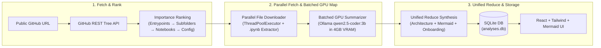

# GitHub Repository Explainer (Local Hybrid LLM Edition)

Paste any public GitHub repository URL and get back a complete, grounded engineering overview:
- **Plain-English Architecture Summary**: Grounded strictly in the repository's real source code.
- **Interactive Mermaid.js Architecture Diagram**: Grouped by folder (`Root`, `src/`, `scripts/`, `notebooks/`, etc.) with Left-to-Right / Top-Down layout toggle, zoom up to 400%, click-and-drag pan, and fullscreen mode.
- **All-File Ranked Explanations**: Summarizes every project file in decreasing order of architectural importance (entrypoints → core subfolder code → notebooks → configs & docs).
- **"Start Here" Contributor Onboarding Guide**: Recommended file reading order, local setup steps, and where to make common changes.
- **SQLite History**: Instantaneous reload of previously analyzed repositories.

---

## Implementation Demo Video

<video src="./portfolio-demo/github-repo-explainer-demo.webm" controls autoplay loop muted width="100%"></video>

- **Download / View 1080p Demo Video**: [portfolio-demo/github-repo-explainer-demo.webm](./portfolio-demo/github-repo-explainer-demo.webm)

---

## System Architecture (Map-Reduce Pipeline)



---

## Quick Start

### 1. Prerequisites
1. **Ollama**: Download from [ollama.com/download](https://ollama.com/download) and pull the fast coding model:
   ```powershell
   ollama pull qwen2.5-coder:3b
   ```
2. **Python 3.10+** and **Node.js 18+**.

### 2. Run the Full-Stack App
Double-click **`start-local.bat`** in the project root, or start Backend and Frontend in two terminals:

**Terminal 1 — FastAPI + SQLite Backend (`http://localhost:8000`)**:
```powershell
cd Backend
python -m venv venv
.\venv\Scripts\Activate.ps1
pip install -r requirements.txt
uvicorn main:app --host 0.0.0.0 --port 8000 --reload
```

**Terminal 2 — React + Tailwind Frontend (`http://localhost:5173`)**:
```powershell
cd Frontend
npm.cmd install
npm.cmd run dev
```
